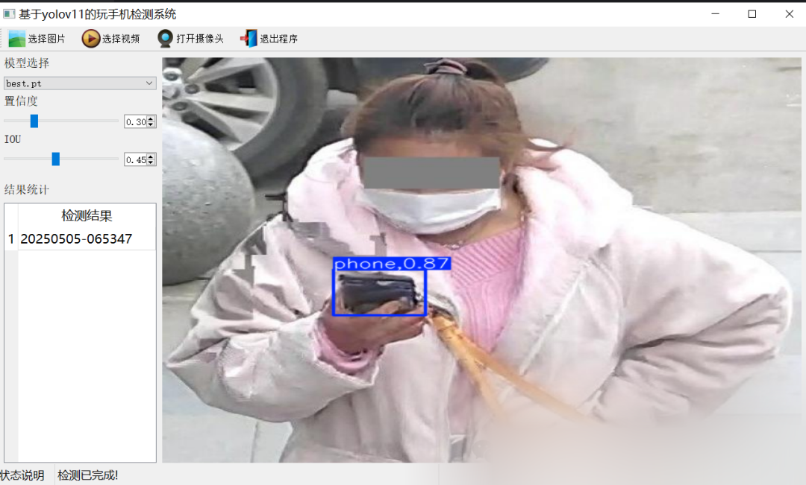
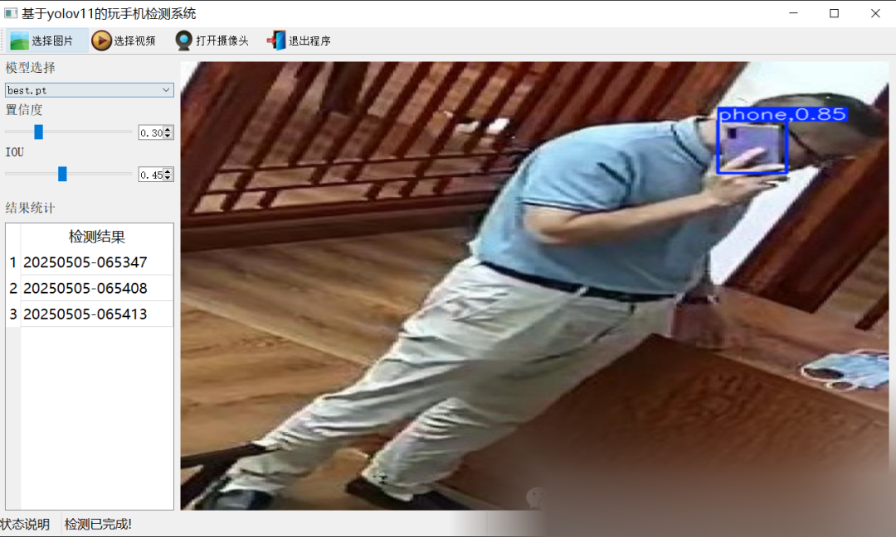
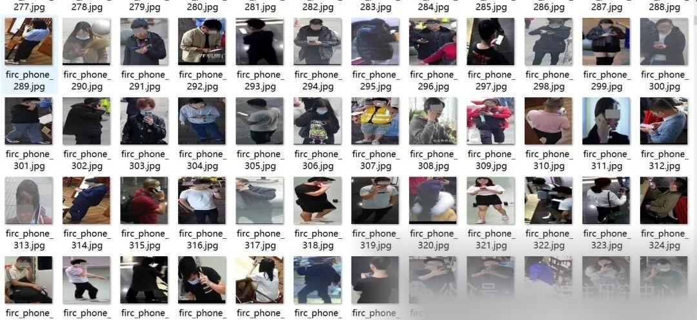
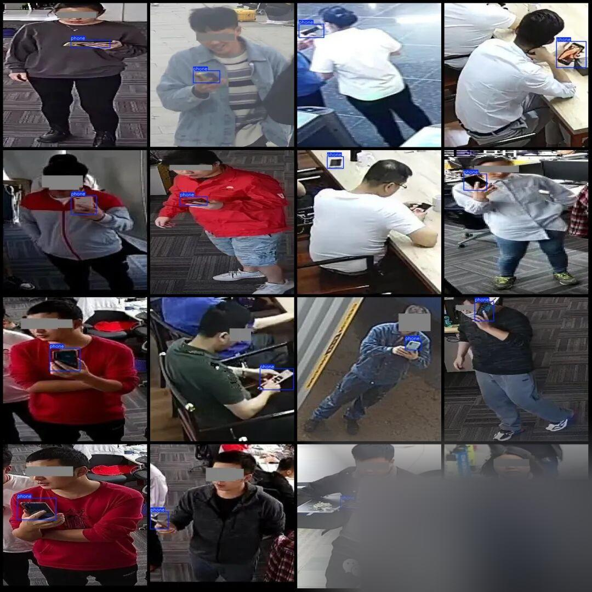

# Calling and using mobile phone detection system based on YOLOv11 in Python source code + PyTorch model + evaluation indicator curve + exquisite GUI interface

[Algorithm Introduction]This system is an intelligent monitoring solution designed for scenarios where mobile phones are not allowed to be carried.

[Algorithm Introduction]
This system is an intelligent monitoring solution designed for scenarios where mobile phones are not allowed to be carried. Relying on the YOLOv11 deep learning model, it can detect and locate mobile phones in the scene in real-time. Once the target device is identified, it is determined to be a violation and triggers an alarm mechanism.

YOLOv11, as a new generation of object detection algorithm, achieves breakthrough optimization in feature extraction and multi-scale target recognition capabilities. Its dynamic anchor adaptive mechanism and multi-level feature fusion architecture enable the model to precisely capture the device shape under different angles and occlusion states, with an accuracy rate exceeding 95% for small-sized devices (such as foldable screen phones) and complex backgrounds (such as metal tools interference). At the same time, YOLOv11 significantly enhances the model's generalization ability under lighting changes and dynamic interference scenarios by introducing attention modules and adversarial training strategies.

The detection results support the visualization of result saving. This system effectively replaces manual inspection. Reduce the rate of non-compliance inspections by more than 80%. Assisting in preventing cheating in examinations. Industrial scenarios for information leak prevention and other scenarios to achieve all-weather, Unobstructed supervision. To provide intelligent solutions for industries with high security requirements. Highly reliable behavior control tool.

[Effect Display]

Editor

Editor

[Mobile Phone Handling Rules]

In scenarios where mobile phones are not allowed, real-time video or camera surveillance is conducted. Upon detecting a mobile phone, it is determined to be engaging in the behavior of playing with a mobile device.

[Training Dataset Introduction]

The dataset has been desensitized, and occluding the face does not affect the detection of mobile phones.

Dataset format: Pascal VOC format + YOLO format (txt file without split path, only contains jpg images and corresponding VOC format xml files and yolo format txt files)

Number of images (number of jpg files): 8061

Number of annotations (number of xml files): 8061

Number of annotations (number of txt files): 8061

Labeling category count: 1

Label category name (Note that the order of categories in the yolo format does not correspond to this, but is based on the labels folder's classes.txt): ["phone"]

Number of boxes labeled in each category:

Phone frame count = 8247

Total frames: 8247

Using labelImg:

Annotation rules: Draw a rectangle around the category.

Important Notice: No

Special : This dataset does not guarantee the accuracy or precision of the trained models or weight files. The dataset is provided with accurate and reasonable annotations only.

Image Preview:



Editor

Annotation example:



Editor

[Training Information]


Parameters


Value


Number of training set images


7265


Number of images in the validation set


808


Training map


97.6%


Training Accuracy


95.7%


Training recall rate


94.2%


[Validation set accuracy statistics]


Class


Images


Instances


P


R


mAP50


mAP50-95


all


808


824


0.957


0.942


0.976


0.615


[Test Environment]

windows10
anaconda3+python3.8
torch==2.3.0
ultralytics==8.3.81
onnxruntime==1.16.3

[Interface Design]

```
class Ui_MainWindow(QtWidgets.QMainWindow):
signal = QtCore.pyqtSignal(str, str)
def setupUi(self):
self.setObjectName("MainWindow")
self.resize(1280, 728)
self.centralwidget = QtWidgets.QWidget(self)
self.centralwidget.setObjectName("centralwidget")
self.weights_dir = './weights'
self.picture = QtWidgets.QLabel(self.centralwidget)
self.picture.setGeometry(QtCore.QRect(260, 10, 1010, 630))
self.picture.setStyleSheet("background:black")
self.picture.setObjectName("picture")
self.picture.setScaledContents(True)
self.label_2 = QtWidgets.QLabel(self.centralwidget)
self.label_2.setGeometry(QtCore.QRect(10, 10, 81, 21))
self.label_2.setObjectName("label_2")
self.cb_weights = QtWidgets.QComboBox(self.centralwidget)
self.cb_weights.setGeometry(QtCore.QRect(10, 40, 241, 21))
self.cb_weights.setObjectName("cb_weights")
self.cb_weights.currentIndexChanged.connect(self.cb_weights_changed)
self.label_3 = QtWidgets.QLabel(self.centralwidget)
self.label_3.setGeometry(QtCore.QRect(10, 70, 72, 21))
self.label_3.setObjectName("label_3")
self.hs_conf = QtWidgets.QSlider(self.centralwidget)
self.hs_conf.setGeometry(QtCore.QRect(10, 100, 181, 22))
self.hs_conf.setProperty("value", 25)
self.hs_conf.setOrientation(QtCore.Qt.Horizontal)
self.hs_conf.setObjectName("hs_conf")
self.hs_conf.valueChanged.connect(self.conf_change)
self.dsb_conf = QtWidgets.QDoubleSpinBox(self.centralwidget)
self.dsb_conf.setGeometry(QtCore.QRect(200, 100, 51, 22))
self.dsb_conf.setMaximum(1.0)
self.dsb_conf.setSingleStep(0.01)
self.dsb_conf.setProperty("value", 0.25)
self.dsb_conf.setObjectName("dsb_conf")
self.dsb_conf.valueChanged.connect(self.dsb_conf_change)
self.dsb_iou = QtWidgets.QDoubleSpinBox(self.centralwidget)
self.dsb_iou.setGeometry(QtCore.QRect(200, 160, 51, 22))
self.dsb_iou.setMaximum(1.0)
self.dsb_iou.setSingleStep(0.01)
self.dsb_iou.setProperty("value", 0.45)
self.dsb_iou.setObjectName("dsb_iou")
self.dsb_iou.valueChanged.connect(self.dsb_iou_change)
self.hs_iou = QtWidgets.QSlider(self.centralwidget)
self.hs_iou.setGeometry(QtCore.QRect(10, 160, 181, 22))
self.hs_iou.setProperty("value", 45)
self.hs_iou.setOrientation(QtCore.Qt.Horizontal)
self.hs_iou.setObjectName("hs_iou")
self.hs_iou.valueChanged.connect(self.iou_change)
self.label_4 = QtWidgets.QLabel(self.centralwidget)
self.label_4.setGeometry(QtCore.QRect(10, 130, 72, 21))
self.label_4.setObjectName("label_4")
self.label_5 = QtWidgets.QLabel(self.centralwidget)
self.label_5.setGeometry(QtCore.QRect(10, 210, 72, 21))
self.label_5.setObjectName("label_5")
self.le_res = QtWidgets.QTextEdit(self.centralwidget)
self.le_res.setGeometry(QtCore.QRect(10, 240, 241, 400))
self.le_res.setObjectName("le_res")
self.setCentralWidget(self.centralwidget)
self.menubar = QtWidgets.QMenuBar(self)
self.menubar.setGeometry(QtCore.QRect(0, 0, 1110, 30))
self.menubar.setObjectName("menubar")
self.setMenuBar(self.menubar)
self.statusbar = QtWidgets.QStatusBar(self)
self.statusbar.setObjectName("statusbar")
self.setStatusBar(self.statusbar)
self.toolBar = QtWidgets.QToolBar(self)
self.toolBar.setToolButtonStyle(QtCore.Qt.ToolButtonTextBesideIcon)
self.toolBar.setObjectName("toolBar")
self.addToolBar(QtCore.Qt.TopToolBarArea, self.toolBar)
self.actionopenpic = QtWidgets.QAction(self)
icon = QtGui.QIcon()
icon.addPixmap(QtGui.QPixmap(":/images/1.png"), QtGui.QIcon.Normal, QtGui.QIcon.Off)
self.actionopenpic.setIcon(icon)
self.actionopenpic.setObjectName("actionopenpic")
self.actionopenpic.triggered.connect(self.open_image)
self.action = QtWidgets.QAction(self)
icon1 = QtGui.QIcon()
icon1.addPixmap(QtGui.QPixmap(":/images/2.png"), QtGui.QIcon.Normal, QtGui.QIcon.Off)
self.action.setIcon(icon1)
self.action.setObjectName("action")
self.action.triggered.connect(self.open_video)
self.action_2 = QtWidgets.QAction(self)
icon2 = QtGui.QIcon()
icon2.addPixmap(QtGui.QPixmap(":/images/3.png"), QtGui.QIcon.Normal, QtGui.QIcon.Off)
self.action_2.setIcon(icon2)
self.action_2.setObjectName("action_2")
self.action_2.triggered.connect(self.open_camera)
self.actionexit = QtWidgets.QAction(self)
icon3 = QtGui.QIcon()
icon3.addPixmap(QtGui.QPixmap(":/images/4.png"), QtGui.QIcon.Normal, QtGui.QIcon.Off)
self.actionexit.setIcon(icon3)
self.actionexit.setObjectName("actionexit")
self.actionexit.triggered.connect(self.exit)
self.toolBar.addAction(self.actionopenpic)
self.toolBar.addAction(self.action)
self.toolBar.addAction(self.action_2)
self.toolBar.addAction(self.actionexit)
self.retranslateUi()
QtCore.QMetaObject.connectSlotsByName(self)
self.init_all()
```

[Model can detect 1 class]

phone

[Common Evaluation Parameters Introduction]

In the task of object detection, evaluating the performance of a model is crucial. The terms you mentioned are commonly used metrics for assessing the performance of a model. Here are detailed explanations of these terms:

1.

1. **Class**

:

-

-

This usually refers to the categories of objects that the model is designed to detect. For example, a model may be trained to detect different categories of objects such as vehicles, pedestrians, or animals.

-

1.

1. **Images**

:

-

-

Represents the number of images in the validation set. The validation set is a dataset used to evaluate model performance, separate from the training set to ensure fairness in evaluation results.

-

1.

1. **Instances**

:

-

-

The total number of target objects in all images. This includes the sum of all category objects, for example, if the validation set contains 100 images, each image has an average of 5 target objects, then Instances is 500.

-

1.

1. **P (Precision)**

:

-

-

Precision is the proportion of actual positive samples predicted by the model. The formula is: Precision = TP / (TP + FP), where TP represents true positives (True Positives) and FP represents false positives (False Positives).

-

1.

1. **R (Recall)**

:

-

-

Recall is the proportion of all true positives correctly predicted by the model. The formula is: Recall = TP / (TP + FN), where FN represents false negatives.

-

1.

1. **mAP50**

:

-

-

Mean Average Precision (mAP) at an IoU threshold of 0.5, where IoU is the metric used to measure the degree of overlap between predicted bounding boxes and ground truth bounding boxes. mAP is a comprehensive metric that considers both precision and recall when evaluating model performance across different recall levels. At an IoU of 0.5, if the overlap between the predicted bounding box and the ground truth bounding box reaches or exceeds 50%, it is considered correct.

-

1.

1. **mAP50-95**

:

-

-

This represents the average accuracy of the model across IoU values ranging from 0.5 to 0.95 (with a step of 0.05). This is a more stringent evaluation criterion, demanding higher overlap between predicted bounding boxes and ground truth boxes. In object detection tasks, higher IoU thresholds mean that models need to be more accurate in their target object localization. The computation of mAP50-95 takes into account multiple IoU thresholds ranging from lenient to strict, thus providing a more comprehensive assessment of the model's performance.

-

These indicators collectively form an important framework for evaluating the performance of target detection models. By comparing the performance of different models on these indicators, It can be determined which model may be more effective in practical applications.

[Usage Steps]

Usage Steps:
1. Install the YOLOv11 environment according to the official framework ultralytics installation tutorial, and install PyQt5.
2. After switching to the YOLOv11 environment you have installed, and switch to the source code directory, execute python main.py to start the interface, and perform the corresponding operations.

[Provided Files]

Python source code
YOLOv11n.pt model
Training map, P, R curves (in weights\results.png)
Test images (under test_img folder)

Please provide the training dataset, and you can find the address in mytxt.txt file.


## Payment

Here is a pay link on Stripe ( https://buy.stripe.com/3cs8yP7sY87d0vu9AB ). Please contact me lonlonago@foxmail.com after funding $89, and I will send you a complete data files , thank you!


